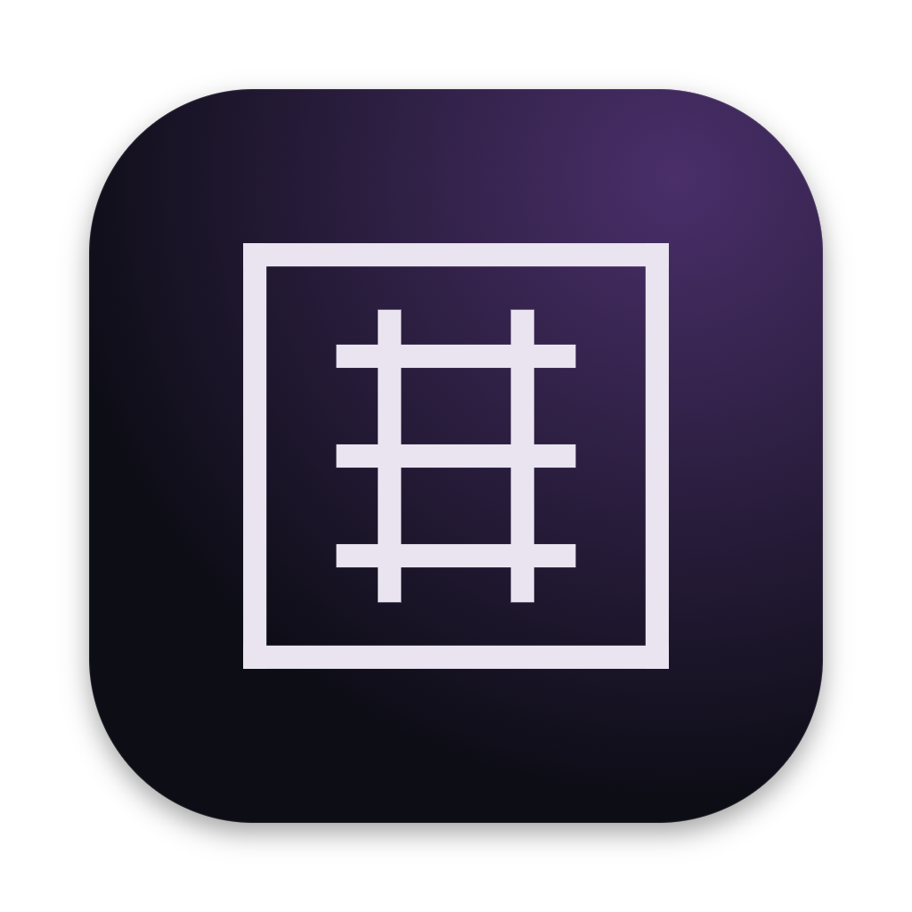

<p align="center">
  
</p>

# Abacus Desktop

A desktop app for [abacus](https://github.com/empero-org/abacus), the coding
agent. It drives the abacus CLI you already have, in a window: your projects
and their sessions in a sidebar, a conversation that streams the agent's
reasoning, tool calls and answers, approvals and questions where you can see
them, the changes a turn made, and a terminal.

The agent itself is the CLI. The app runs `abacus app-server` for the project
you open and talks to it over JSON-RPC, so everything the agent does (models,
providers, tools, skills, plugins, sessions, Abacus Sync) is the CLI's, and a
change made in the app is the change the terminal UI would make.

## Features

- **Projects and sessions.** Every project you have used abacus in, with its
  sessions, including sessions synced from your other devices with Abacus Sync.
  The projects worked in last come first, each with its latest sessions in
  view. Pin a project to keep it at the top of the list, or a session to keep
  it above everything else. Open one to continue it, or start a new thread.
- **The conversation.** Streaming answers in markdown with highlighted code,
  math and diagrams; reasoning you can fold away; each tool call as one line
  you can open.
- **The composer.** `/` completes commands, skills and plugin commands, `@`
  completes files in the project. Paste, drop or attach images and text files.
  What you send while the agent works waits in a stack above the box and goes
  when the turn ends; Steer hands a message to the agent mid-turn, and Send now
  stops the turn and sends it. Esc stops the agent.
- **Profiles and providers.** Switch profiles from the composer. Add providers
  in Settings (any OpenAI-compatible or Anthropic API, with its key, headers
  and body fields) and make profiles from the models they serve. On first run
  the window connects a provider and picks a model with you.
- **Auto and YOLO.** In Auto, a reviewer model checks anything beyond edits in
  the project before it runs; when it cannot decide, the action waits for you
  above the composer, as does any question the agent asks. YOLO runs
  everything.
- **Changes.** The diff of the working tree after a turn.
- **Terminal.** Shells in the project, in tabs, under the conversation
  (Ctrl+`).
- **Browser.** A browser pane beside the conversation, with tabs and an
  address bar, that finds your dev server. abacus can use it too: open pages,
  read them, click, type and take screenshots while you watch, with clicks and
  typing checked like any other action. Pages run in their own session, apart
  from the app.
- **Background tasks.** The subagents abacus started, what each is doing, and
  its transcript, in a panel you can expand or stop them from.
- **Idle compaction.** A long thread left idle for a few minutes after a turn
  is summarised while the provider still has it cached, so your next message
  does not send the whole history again at full price; a divider in the
  conversation says so, and a reopened thread shows one wherever its history
  was summarised. Typing holds it off, and it never runs against a model
  server on your machine or local network. Settings → Agent turns it off.
- **Settings.** Theme, profile, reasoning effort, mode, profiles and
  providers, and your sync status.

## Install

The Abacus installer sets up the abacus CLI and, when you choose it, this app.
On macOS and Linux:

```sh
curl -fsSL https://abacus.empero.org/install.sh | sh -s -- --desktop
```

On Windows, in PowerShell:

```powershell
$env:ABACUS_INSTALL="desktop"; irm https://abacus.empero.org/install.ps1 | iex
```

`abacus update` updates both later. Or download the app from the
[latest release](https://github.com/empero-org/abacus-desktop/releases/latest)
and install the CLI with the same command, without `--desktop`:

| System                 | File                                                       |
| ---------------------- | ---------------------------------------------------------- |
| macOS, Apple silicon   | `Abacus-mac-arm64.dmg`                                     |
| macOS, Intel           | `Abacus-mac-x64.dmg`                                       |
| Windows                | `Abacus-win-x64.exe`                                       |
| Debian, Ubuntu         | `Abacus-linux-amd64.deb`                                   |
| Debian, Ubuntu (arm64) | `Abacus-linux-arm64.deb`                                   |
| Other Linux            | `Abacus-linux-x86_64.AppImage`, `Abacus-linux-x64.tar.gz`  |
| Other Linux (arm64)    | `Abacus-linux-arm64.AppImage`, `Abacus-linux-arm64.tar.gz` |

The app is not notarized or code-signed yet. The installer sets it up without
warnings; a downloaded copy needs System Settings → Privacy & Security → Open
Anyway the first time on macOS, and More info → Run anyway if SmartScreen
stops it on Windows.

The app needs the abacus CLI 0.7.1 or newer. It looks for `abacus` in
`~/.local/bin`, `~/.cargo/bin`, the usual system locations and your `PATH`;
`ABACUS_BIN` points it at a specific binary.

## Development

You need Node 24.14 or newer and pnpm 10 (`mise install` sets up both).

```sh
pnpm install
pnpm dev                    # the app with hot reload
pnpm dev -- ~/my-project    # ...opened straight into a project
pnpm typecheck
pnpm test
pnpm lint
pnpm package                # installers for this platform, in packages/desktop/dist
```

The repository has two packages:

- `packages/desktop`: the Electron main process (one `abacus app-server` per
  window, the terminals, the browser) and the preload bridge.
- `packages/ui`: the window itself, in React. `src/abacus` is the app;
  `src/components` holds the UI primitives it is built from.

## License

Apache License 2.0; see [LICENSE](LICENSE). Abacus Desktop started from
[ZCode](https://github.com/zai-org/ZCode) by Z.ai; see [NOTICE](NOTICE) and
[THIRD-PARTY-NOTICES.md](THIRD-PARTY-NOTICES.md).
